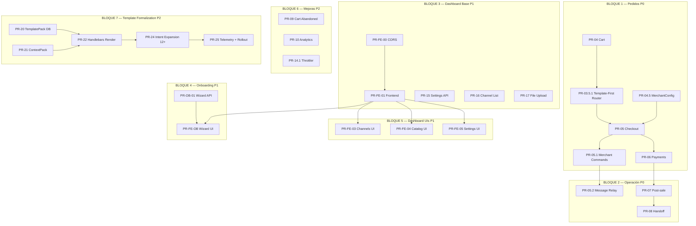

# PR Stack — Core V1 MVP (WhatsApp-first)

> Objetivo: proveer una “autopista” de PRs pequeños, dependientes y mergeables para construir el Core V1 MVP.
> 
> Regla de oro: cada PR se ejecuta con un **PR Brief** (1 página) antes de implementar.

## Convenciones

- IDs: `PR-01`, `PR-02`, ...
- Artefactos:
  - Stack global: `docs/plan/PR-STACK-core-v1.md`
  - Briefs: `docs/plan/pr-briefs/PR-XX-<slug>.md`
- DoD global (aplica a todos los PRs):
  - Idempotencia implementada y testeada donde aplique (`message_id`, `payment_intent_id`).
  - Estado persistido en Postgres (sin lógica “solo memoria”).
  - Guardrails: la IA NO inventa precio/stock/políticas/ETA.
  - `pnpm lint` y `pnpm test` pasan.

## Comandos estándar

- Dev: `pnpm dev`
- Lint: `pnpm lint`
- Test: `pnpm test`
- DB (si aplica): `pnpm db:migrate` / `pnpm db:generate`

---

## PRs Mergeados (histórico)

> Registro de PRs ya completados. Los PRs pendientes están en la sección **Roadmap de Ejecución** abajo.

### PR-01 — Inbound WhatsApp: normalización + dedupe persistido ✅ MERGED
- **Objetivo:** recibir webhook inbound, normalizar mensaje y asegurar "exactly-once" lógico vía dedupe por `message_id`.
- **Depende de:** bootstrap completado.
- **Incluye:** endpoint webhook + validación básica + persistencia de inbound events + dedupe por constraint unique.
- **Excluye:** NLP/LLM avanzado, catálogo/carrito.
- **DoD específico:** test de webhook duplicado (mismo `message_id`) se procesa 1 vez.

### PR-02 — Modelos base: merchant/customer/conversation + estado mínimo ✅ MERGED
- **Objetivo:** resolver identidad por teléfono y mantener `conversation_id` con estado mínimo persistido.
- **Depende de:** PR-01.
- **Incluye:** tablas/modelos + repos + servicios; correlación por `conversation_id` en logs.
- **Excluye:** flows de compra.

### PR-03 — Catálogo: import CSV + búsqueda simple ✅ MERGED
- **Objetivo:** cargar catálogo por CSV y buscar productos por texto.
- **Depende de:** PR-02.
- **Incluye:** schema productos/variantes/stock/precio + import service + búsqueda.
- **Excluye:** recomendaciones ML, integraciones Shopify/Woo.
- **Notas:** precios/stock siempre desde backend (guardrails).

### PR-03.5 — Outbound Sender + Orchestrator básico + Búsqueda catálogo conversacional ✅ MERGED
- **Objetivo:** habilitar conversación end-to-end (recibir → entender → responder) y búsqueda de catálogo via chat.
- **Depende de:** PR-03 ✅.
- **Incluye:**
  - WhatsApp Outbound Sender (enviar mensajes via Meta Cloud API)
  - Orchestrator básico (inbound → identity → router → outbound)
  - IntentRouter simple por keywords (SEARCH_PRODUCT, GREETING, HELP, UNKNOWN)
  - Merchant resolver por número receptor
  - Flujo de búsqueda catálogo con resultados paginados
- **Excluye:** LLM/NLP avanzado, carrito, checkout, botones interactivos.
- **DoD específico:** 
  - Usuario envía "busco X" → bot responde con productos del catálogo
  - Usuario envía "hola" → bot responde con saludo
  - Test e2e: inbound → outbound response
- **Issue:** #14

### PR-03.6 — LLM Adapter: Groq + System Prompt conversacional ✅ MERGED
- **Objetivo:** integrar LLM con arquitectura adapter para respuestas naturales con tono vendedor/persuasivo.
- **Depende de:** PR-03.5 ✅.
- **Incluye:**
  - Módulo `llm/` con interface `LlmProvider` abstracta
  - `GroqLlmProvider` como implementación inicial (económico para MVP)
  - System prompt composable: base + playbook + merchant + context
  - Guardrails anti-hacking y anti-injection
  - Feature flag `LLM_ENABLED` para toggle
  - Fallback a respuestas templated si LLM falla
  - Stubs de prompts por industria (prepara PR-11)
- **Excluye:** RAG/vector DB, tool calling complejo, multi-provider routing.
- **DoD específico:**
  - Bot responde con lenguaje natural usando Groq
  - System prompt impide manipulación (prompt injection básico)
  - Fallback funcional si LLM falla
  - Provider intercambiable sin cambiar orchestrator
- **Issue:** #16

### PR-03.7 — Catalog Management API: Import masivo + CRUD productos ✅ MERGED
- **Objetivo:** exponer endpoints HTTP para (a) carga masiva de catálogo por CSV y (b) CRUD básico de productos/variantes, con multi-tenancy por `merchant`.
- **Depende de:** PR-03.
- **Incluye:**
  - Endpoint bulk import CSV (usa `ImportService` existente)
  - Endpoints CRUD de productos (create/update/delete/list/get) y variantes mínimas
  - Autenticación por `merchant.apiKey` (header `Authorization: Bearer <apiKey>` o `x-api-key`)
  - Validaciones DTOs + límites de payload (MVP)
  - Tests unitarios + e2e básicos (happy path + multi-tenant)
- **Excluye:** UI/admin dashboard, integraciones externas (POS/ERP), editor avanzado, RAG.
- **DoD específico:**
  - Import CSV crea/actualiza por SKU (idempotente) y retorna stats
  - CRUD no permite acceder/modificar productos de otro merchant
  - `pnpm test` pasa

### PR-03.8 — Meta WhatsApp Webhook Compliance: GET verify + raw payload + signature guard ✅ MERGED
- **Objetivo:** hacer el backend compatible con el flujo real de Meta WhatsApp Cloud API webhooks (verificación, payload crudo, firma).
- **Depende de:** PR-01 (inbound dedupe), PR-03.5 (outbound sender).
- **Incluye:**
  - GET `/webhooks/whatsapp` para verificación (`hub.mode`, `hub.verify_token` → `hub.challenge`)
  - POST `/webhooks/whatsapp` acepta payload crudo de Meta (`entry/changes/value/messages[]`)
  - Mapper `whatsapp-webhook.mapper.ts` que convierte payload Meta → `InboundMessageDto` normalizado
  - Guard `MetaSignatureGuard` para validar `X-Hub-Signature-256` con HMAC SHA-256 (timing-safe)
  - `rawBody: true` en NestJS bootstrap para cálculo correcto de firma
  - Manejo de eventos `statuses` con early return (200 OK sin procesar)
  - Env vars nuevas: `WHATSAPP_WEBHOOK_VERIFY_TOKEN`, `WHATSAPP_APP_SECRET`
  - Actualización de `.env.example` y `README.md` con instrucciones de setup
  - Tests E2E + unitarios (verify, mapper, signature)
- **Excluye:** media download, templates/botones interactivos, cambios al orchestrator/LLM.
- **DoD específico:**
  - GET verify con token correcto → retorna `hub.challenge` (text/plain)
  - GET verify con token incorrecto → 403
  - POST mensaje text → procesado por pipeline existente
  - POST con `statuses` → 200 OK sin procesar
  - Si `WHATSAPP_APP_SECRET` presente: firma inválida → 401; firma válida → 200
  - Si `WHATSAPP_APP_SECRET` ausente: log warning, permite request (modo dev)
  - `pnpm lint` y `pnpm test` pasan
- **Notas:**
  - Sin cambios de DB (no hay migraciones)
  - Referencia: [Meta Webhooks Getting Started](https://developers.facebook.com/docs/graph-api/webhooks/getting-started)
  - Referencia: [WhatsApp Webhook Components](https://developers.facebook.com/docs/whatsapp/cloud-api/webhooks/components)

### PR-03.9 — Transactional Outbox: WhatsApp outbound confiable ✅ MERGED
- **Objetivo:** evitar dual-write y garantizar envío eventual de outbound WhatsApp si el commit DB ocurrió (enqueue en outbox + dispatcher async).
- **Depende de:** PR-03.5 ✅ (outbound sender) y PR-03.8 ✅ (webhook compliance).
- **Incluye:**
  - Tabla `OutboxMessage` (Prisma) + índices + dedupeKey
  - `OutboxService.enqueueWhatsAppText(...)` (reemplaza envíos directos)
  - Worker scheduler con `FOR UPDATE SKIP LOCKED`, retries + backoff
  - Logs PII-safe + config flags
  - Tests unitarios (enqueue + dispatcher success/failure)
- **Excluye:** Kafka/SQS/Redis, CDC/Debezium, nuevos canales.
- **DoD específico:**
  - Webhook ACK rápido (no bloquea por envío)
  - 2 instancias worker sin doble-procesamiento por `SKIP LOCKED`
  - `pnpm lint`, `pnpm test`, `pnpm db:migrate` pasan
### PR-03.10 — Conversation Memory: historial corto + summary + retención ✅ MERGED
- **Objetivo:** habilitar continuidad conversacional "humana" con historial corto acotado (TTL) y resumen+facts long-lived, más jobs de cleanup/sumarización.
- **Depende de:** PR-03.5 ✅ (orchestrator), PR-03.6 ✅ (LLM adapter).
- **Incluye:**
  - Modelo `MessageLog` (IN + OUT) con `expiresAt` para TTL
  - Campos en `Conversation`: `summary`, `memoryFacts`, `lastIntent`, `lastSummarizedAt`
  - Jobs `@nestjs/schedule`:
    - `message-log-cleanup.service.ts`: elimina logs expirados + cap por conversación
    - `conversation-summarization.service.ts`: actualiza summary + facts periódicamente
  - Context builder extendido: últimos K logs + summary+facts + estado de negocio
  - Config por env + override por merchant en `playbookConfig.memory`
  - Observabilidad PII-safe
- **Excluye:** archiving S3, partitioning, anonimización masiva, búsqueda CRM.
- **DoD específico:**
  - Migración crea `message_logs` + nuevos campos en `conversations`
  - Logs acotados por TTL + cap (job cleanup funcional)
  - Summary/facts se actualizan periódicamente (job summarization funcional)
  - LLM context usa últimos K + summary sin romper guardrails
  - Webhook dedupe existente no se rompe
  - `pnpm lint`, `pnpm test`, `pnpm db:migrate` pasan
- **Issue:** [#28](https://github.com/ferbbo/closy-bot/issues/28), [#29](https://github.com/ferbbo/closy-bot/issues/29), [#30](https://github.com/ferbbo/closy-bot/issues/30), [#31](https://github.com/ferbbo/closy-bot/issues/31), [#32](https://github.com/ferbbo/closy-bot/issues/32), [#33](https://github.com/ferbbo/closy-bot/issues/33), [#34](https://github.com/ferbbo/closy-bot/issues/34)
- **Brief:** `docs/plan/pr-briefs/PR-03.10-conversation-memory-retention.md` ✅

### PR-03.11 — Multi-channel per Merchant: Channel model + lookup + dynamic outbound ✅ MERGED
- **Objetivo:** permitir que cada Merchant tenga múltiples canales WhatsApp (y preparar Instagram), con resolución automática por `phone_number_id` y credenciales por canal.
- **Depende de:** PR-02 ✅, PR-03.9 ✅.
- **Incluye:**
  - Modelo `Channel` (Prisma): `type`, `externalId`, `merchantId`, `credentials`, `displayName`, `isActive`
  - Enum `ChannelType { WHATSAPP, INSTAGRAM }`
  - `ChannelRepository`: `findByTypeAndExternalId()`, `findByMerchantId()`, `findById()`
  - `MerchantResolverService.resolveByChannel(type, externalId)` → `{ merchant, channel }` real (no `findFirst`)
  - FKs: `Conversation.channelId`, `OutboxMessage.channelId` (nullable para backwards compat)
  - `WhatsAppOutboundService.sendTextMessageWithCredentials(to, text, credentials)`
  - `OutboxDispatcher` usa credentials del channel (fallback a env vars si no hay channelId)
  - Unknown channel handling: log structured warning + 200 OK (sin crash)
  - Migración backwards-compatible: crea Channel desde Merchant + env vars existentes
  - Tests unit + e2e (multi-merchant multi-channel, channel desconocido)
- **Excluye:** UI admin para CRUD channels, Instagram OAuth completo, encrypt helper real, límites por plan.
- **DoD específico:**
  - Migración crea tabla `channels` + FKs en `conversations` y `outbox_messages`
  - Webhook inbound enruta al merchant correcto por `phone_number_id`
  - 2+ WhatsApps de diferente merchant funcionan simultáneamente
  - Channel desconocido → 200 OK + log structured sin crash
  - Outbound usa credentials del channel (no env vars globales)
  - Backwards compat: outbox messages sin `channelId` usan env vars
  - `pnpm lint`, `pnpm test`, `pnpm db:migrate` pasan
- **Brief:** `docs/plan/pr-briefs/PR-03.11-multi-channel-merchant.md`

### PR-11 — Playbooks: ropa/belleza/minimarket (defaults) ✅ MERGED
- **Objetivo:** configurar defaults por industria (preguntas mínimas, mensajes base, reglas).
- **Depende de:** PR-02 ✅ (merchant), PR-03.6 ✅ (LLM prompts).
- **Incluye:** seed/config por playbook + selección por merchant + composición de prompts LLM.
- **Excluye:** editor visual avanzado.
- **Nota:** Playbooks están configurados y activos. Los flows de cart/checkout (PR-04/05) usarán estos playbooks.

### PR-12 — Auth Social OIDC: Google + Microsoft con sesión PostgreSQL ✅ MERGED
- **Objetivo:** habilitar autenticación OIDC para Merchants con sesión server-side para acceso al dashboard (RNF-08).
- **Depende de:** PR-02 ✅.
- **Incluye:**
  - Modelos `MerchantIdentity` + `Session` (Prisma)
  - Interface `OidcProvider` + implementaciones Google y Microsoft
  - `SessionService` + `PostgresSessionStore` (diseño migrable a Redis)
  - Endpoints: `/auth/login/:provider`, `/auth/callback/:provider`, `/auth/me`, `/auth/logout`
  - `SessionAuthGuard` para endpoints protegidos
  - Session cleanup job (@nestjs/schedule)
  - Tests unit + e2e
- **Excluye:** UI/frontend, JWT, refresh tokens, roles/permisos, logout global del provider.
- **DoD específico:**
  - Migración crea tablas `merchant_identities` + `sessions`
  - Login Google/Microsoft crea sesión y setea cookie HttpOnly
  - `/auth/me` retorna merchant con cookie válida, 401 sin ella
  - `/auth/logout` invalida sesión server-side
  - Cleanup job elimina sesiones expiradas
  - `pnpm lint`, `pnpm test`, `pnpm db:migrate` pasan
- **Tech notes:**
  - OIDC Authorization Code Flow (no implicit)
  - State parameter con cookie temporal para CSRF protection
  - 1 cuenta OIDC = 1 merchant (sin roles por ahora)
  - Session store pattern permite swap a Redis sin cambiar AuthService

### PR-13 — Meta Embedded Signup: WhatsApp Channel Onboarding ✅ MERGED
- **Objetivo:** permitir que un merchant con sesión activa conecte su WhatsApp Business Account via Meta Embedded Signup, creando un `Channel` con `wabaId`, `phoneNumberId`, y credentials válidas.
- **Depende de:** PR-03.11 ✅ (Channel model), PR-12 ✅ (Auth OIDC).
- **Incluye:**
  - Módulo `onboarding/` con `MetaOAuthController` y `MetaOAuthService`
  - Endpoints `/onboarding/whatsapp/start` y `/onboarding/whatsapp/callback`
  - Extensión de schema `Channel`: `wabaId`, `status` (enum: pending/connected/error), `statusReason`, `webhookSubscribed`, `lastWebhookAt`
  - OAuth flow completo con anti-CSRF (state cookie httpOnly)
  - Exchange code → access_token → fetch WABA/phone info → create/update Channel
  - Webhook subscription automática post-callback (via Meta Graph API)
  - Endpoint retry manual: `POST /onboarding/whatsapp/:channelId/subscribe-webhook`
  - Guards: SessionAuthGuard en todos los endpoints
  - `.env.example` con: `META_APP_ID`, `META_APP_SECRET`, `META_CONFIG_ID`
  - Tests unit (exchange, subscription) + e2e (mock OAuth)
- **Excluye:** encrypt helper real (mantiene TODO), Instagram OAuth, UI/frontend, múltiples WABAs por merchant.
- **DoD específico:**
  - Merchant puede completar onboarding → Channel creado con status=connected
  - Webhook subscription automática (o retry manual)
  - anti-CSRF validado (state mismatch → 403)
  - Idempotencia: `phone_number_id` ya existente para otro merchant → 409; mismo merchant → update
  - `pnpm lint`, `pnpm test`, `pnpm db:migrate` pasan
- **Tech notes:**
  - OAuth flow: `GET /start` → redirect Meta OAuth URL con config_id → `GET /callback` con code → exchange → fetch WABA info → create Channel
  - Webhook subscription: `POST /{waba_id}/subscribed_apps` post-callback
  - State cookie patrón idéntico a PR-12 (5 min TTL, httpOnly, secure)
  - Si subscription falla: status=connected pero webhookSubscribed=false, retry manual disponible

### PR-14 — Channel Health + Status Management ✅ MERGED
- **Objetivo:** exponer health check por canal para UI "Fix", con diagnóstico, estado, y operaciones de retry controladas.
- **Depende de:** PR-13 ✅ (Channel con status/webhookSubscribed).
- **Incluye:**
  - Endpoint `GET /channels/:id/health` → `ChannelHealthDto` (status, webhookSubscribed, lastWebhookAt, recentErrors, recommendation)
  - `ChannelHealthService`: `getHealth()`, `retryWebhookSubscription()`, `refreshChannelStatus()`
  - Extensión de `Channel`: `lastErrorAt`, `errorCount`
  - Endpoint `POST /channels/:id/retry-webhook` → retry webhook subscription con backoff
  - Endpoint `POST /channels/:id/refresh-status` → re-fetch desde Meta API
  - Rate limiting con `@nestjs/throttler` (5 req/min por IP — ver known limitation)
  - Recommendation logic: "resubscribe_webhook" | "refresh_credentials" | "check_permissions"
  - Guard: SessionAuthGuard + ownership check (channel.merchantId === session.merchantId)
  - Retry con exponential backoff (1s, 2s, 4s, max 3 intentos)
  - Tests unit + e2e
- **Excluye:** background jobs automáticos de health check, alertas/notificaciones, UI/frontend, histórico de errores persistido.
- **DoD específico:**
  - Health endpoint retorna estado correcto con recommendation
  - Retry webhook actualiza `webhookSubscribed` si éxito
  - Rate limit funcional (429 si excede)
  - Ownership check: 403 si channel no pertenece al merchant
  - `pnpm lint`, `pnpm test`, `pnpm db:migrate` pasan
- **Known Limitations:** Rate limit es por IP (no per-merchant). Ver PR-14.1 para mejora.

---

## Roadmap de Ejecución — Bloques Ordenados

> **Visión de producto:** "Tienda en WhatsApp lista en 10 minutos" — WhatsApp-first + dashboard mínimo (torre de control).
>
> **Principio de routing:** **Template-first + LLM fallback** — los flows determinísticos (templates) SIEMPRE ejecutan primero para intents conocidos. El LLM solo participa como fallback para intents no reconocidos y como herramienta de asistencia puntual (summaries, reclasificación). Esto minimiza costos LLM desde el primer lanzamiento.
>
> **Prioridad:** P0 = Bloquea lanzamiento | P1 = Necesario para onboarding completo | P2 = Mejora post-lanzamiento
>
> **Regla:** Cada fase dentro de un bloque se ejecuta secuencialmente. PRs dentro de una misma fase son paralelizables.



---

### BLOQUE 1 — Flujo de Pedidos (P0 CRITICAL)

> Sin esto no hay negocio. Habilita: buscar → carrito → checkout → pedido → pago.

#### Fase 1.1 (paralelizable)

##### PR-04 — Carrito: CRUD conversacional persistido 🔴 CRÍTICO
- **Objetivo:** crear carrito por customer/merchant, agregar/remover/actualizar qty, y mostrar resumen.
- **Depende de:** PR-03.5 ✅, PR-03.6 ✅.
- **Incluye:**
  - Modelos Prisma: `Cart` (status: `active`/`merged`/`abandoned`/`converted`), `CartItem` (productId, variantId, qty, unitPrice, snapshotName)
  - `CartService`: `getOrCreateCart()`, `addItem()`, `removeItem()`, `updateQty()`, `getCartSummary()`, `clearCart()`
  - `CartRepository` con queries multi-tenant (by customerId + merchantId)
  - Flows conversacionales: `add-to-cart.flow.ts`, `view-cart.flow.ts`, `remove-from-cart.flow.ts`
  - Validación de stock al agregar (consulta CatalogService)
  - Snapshot de precio al agregar (no depende de cambios futuros en catálogo)
  - Integración con IntentRouter: nuevos intents `ADD_TO_CART`, `VIEW_CART`, `REMOVE_FROM_CART`
  - Tests unit + e2e
- **Excluye:** checkout, order, payment, cupones/descuentos.
- **DoD específico:**
  - Cliente dice "agrega X" → item en cart + confirmación con resumen
  - Cliente dice "ver carrito" → resumen formateado (items, qtys, subtotal)
  - Stock insuficiente → mensaje claro sin agregar
  - Cart persiste entre reinicios de servidor
  - `pnpm lint`, `pnpm test`, `pnpm db:migrate` pasan
- **Tech notes:**
  - `unitPrice` se captura al momento de agregar (snapshot), no se recalcula
  - Cart se asocia a `Conversation` activa (customerId + merchantId)
  - Cart `active` → máximo 1 por customer+merchant

##### PR-03.5.1 — Template-First Router: Orchestrator Rewrite 🔴 CRÍTICO NUEVO
- **Objetivo:** invertir la lógica del orchestrator para que flows determinísticos (templates) ejecuten SIEMPRE primero. El LLM solo participa como fallback acotado para intents UNKNOWN. Minimiza costos LLM desde día 1.
- **Depende de:** PR-03.5 ✅ (orchestrator), PR-03.6 ✅ (LLM adapter), PR-04 (Cart, para tener todos los flows determinísticos).
- **Incluye:**
  - `RouteDecisionService` (nuevo servicio):
    ```
    classifyAndRoute(text, context) →
      1. IntentRouter.classify(text) → { intent, confidence }
      2. Si intent !== UNKNOWN && confidence >= threshold → TEMPLATE_ROUTE
      3. Si intent === UNKNOWN && LLM_INTENT_ASSIST=true → LLM reclasifica (prompt corto) → retry
      4. Si sigue UNKNOWN → LLM_FALLBACK_ROUTE (si flag activo) o GENERIC_RESPONSE
    ```
  - Rewrite `ConversationOrchestrator.process()`:
    - Elimina toggle binario `if (this.llmEnabled) { LLM para todo }` 
    - Nuevo flujo: `Message → RouteDecision → TEMPLATE_ROUTE (flow) | LLM_FALLBACK_ROUTE`
    - Flows determinísticos: `GreetingFlow`, `HelpFlow`, `SearchCatalogFlow`, `CartFlow` (y futuros `CheckoutFlow`, `PostSaleFlow`)
    - Todos los intents conocidos SIEMPRE ejecutan su flow determinístico, nunca pasan por LLM
  - Feature flags granulares (reemplazan `LLM_ENABLED` monolítico):
    - `LLM_INTENT_ASSIST` (default: `false`): LLM ayuda a reclasificar intents UNKNOWN con prompt corto
    - `LLM_FALLBACK_ENABLED` (default: `false`): LLM genera respuesta para UNKNOWN sin template match
    - `LLM_SUMMARY_ENABLED` (default: `false`): LLM genera summaries para handoff (PR-08)
    - Backward compat: `LLM_ENABLED=true` actúa como alias de todos los flags en `true`
  - `INTENT_CONFIDENCE_THRESHOLD` env var (default: `0.7`)
  - Actualizar `.env.example` con nuevos flags
  - Tests unit + e2e
- **Excluye:** TemplatePack en DB, Handlebars render, telemetry de routing, UI.
- **DoD específico:**
  - Con todos los flags LLM en `false`: bot funciona 100% sin LLM (costo $0)
  - Intents determinísticos (GREETING, SEARCH, CART, etc.) NUNCA generan call LLM
  - Intent UNKNOWN + `LLM_INTENT_ASSIST=true` → LLM reclasifica → si match → flow determinístico
  - Intent UNKNOWN + `LLM_FALLBACK_ENABLED=true` → LLM genera respuesta
  - Intent UNKNOWN + ambos flags `false` → respuesta genérica ("No entendí, escribe ayuda")
  - LLM falla/timeout → graceful fallback a respuesta genérica
  - `pnpm lint`, `pnpm test` pasan
- **Consumer experience:**
  - Sin cambio para el usuario final (mismos flujos conversacionales)
  - Merchant nota respuestas más rápidas (sin latencia LLM en 80%+ de mensajes)
  - Admin puede activar LLM gradualmente por flag
- **Tech notes:**
  - `RouteDecisionService` es inyectable, testeable, y se formaliza en Bloque 7
  - `IntentRouter` keyword-based sigue siendo la primera línea de clasificación
  - LLM para intent assist usa prompt corto y barato (solo clasificación, no generación)
  - Los flows son los "templates" de V1 — en Bloque 7 (P2) se migran a Handlebars/DB
  - Modelo de costos: de ~100 LLM calls/100 msgs → ~15-20 (solo UNKNOWN), reducción 80-100%

##### PR-04.5 — MerchantConfig: políticas, métodos de pago, envío + presets 🔴 NUEVO
- **Objetivo:** persistir configuración operativa del merchant (métodos de pago aceptados, política de envío, política de devolución) con presets por industria.
- **Depende de:** PR-02 ✅ (Merchant), PR-11 ✅ (Playbooks pattern).
- **Incluye:**
  - Modelo Prisma: `MerchantConfig` (1:1 con Merchant)
    - `paymentMethods`: JSON array — `[{ type: 'cod' | 'transfer' | 'payment_link', label, instructions?, bankInfo? }]`
    - `shippingConfig`: JSON — `{ zones?: [], flatRate?: number, freeAbove?: number, estimatedDays?: string }`
    - `returnPolicy`: string (texto libre, mostrado en checkout/post-sale)
    - `currency`: string (default `'COP'`)
    - `orderCodePrefix`: string (default `'ORD'`)
    - `autoConfirmCod`: boolean (default `true`)
  - `MerchantConfigService`: `getOrCreateConfig()`, `updateConfig()`, `getConfigWithDefaults()`
  - Industry presets (como playbooks): defaults para ropa, belleza, minimarket
    - Ropa: COD + transfer, envío flat rate, 5 días hábiles
    - Belleza: COD + transfer + payment_link, envío gratis >$50k
    - Minimarket: COD only, delivery same-day, no devoluciones
  - Seed que crea MerchantConfig junto con merchant
  - Endpoints API (Session auth):
    - `GET /merchants/me/config` → config actual con defaults aplicados
    - `PATCH /merchants/me/config` → actualizar campos específicos
  - Tests unit + e2e
  - Actualizar `BACKEND-EXECUTION-GUIDE.md`
- **Excluye:** payment gateway integration, shipping provider integration, cálculo de envío dinámico.
- **DoD específico:**
  - Al crear merchant → MerchantConfig se crea con presets de industria
  - `GET /merchants/me/config` retorna config con defaults
  - `PATCH /merchants/me/config` actualiza solo campos enviados
  - Checkout (PR-05) puede consultar `paymentMethods` y `shippingConfig`
  - `pnpm lint`, `pnpm test`, `pnpm db:migrate` pasan
- **Tech notes:**
  - Patrón similar a PlaybookConfig pero como tabla separada (no JSON en Merchant)
  - JSON fields validados con DTOs `class-validator`
  - Presets se aplican en `getConfigWithDefaults()` si campo es null

#### Fase 1.2

##### PR-05 — Checkout: captura de datos + creación de orden + notificación merchant 🔴 CRÍTICO
- **Objetivo:** iniciar checkout desde carrito, capturar datos mínimos, crear orden, y notificar al merchant por WhatsApp. **100% template-first** — el LLM NO participa en el flujo de checkout.
- **Depende de:** PR-04, PR-04.5, PR-03.5.1 (Template-First Router).
- **Incluye:**
  - Modelos Prisma:
    - `Order` (orderCode, status enum: `pending_payment`/`confirmed`/`paid`/`shipped`/`delivered`/`cancelled`, customerId, merchantId, totalAmount, shippingAddress, customerName, customerPhone, paymentMethod, notes)
    - `OrderItem` (orderId, productId, variantId, qty, unitPrice, snapshotName)
  - `CheckoutService`: `startCheckout()`, `captureField()`, `createOrder()`
  - Checkout flow conversacional (multi-step):
    1. "Quiero pagar" → bot pregunta nombre (si no lo tiene)
    2. Bot pregunta dirección
    3. Bot muestra resumen + métodos de pago (desde MerchantConfig)
    4. Cliente confirma → Order creada
  - Generación de `orderCode` secuencial por merchant (ej: `ORD-001`)
  - `MerchantNotificationService`: envía WhatsApp al merchant con nuevo pedido
    - Formato: `"Nuevo pedido ORD-001\n{items}\nTotal: $X\nCliente: {name}\nDirección: {address}"`
  - Cart status → `converted` al crear order
  - Intent nuevo: `CHECKOUT`
  - Tests unit + e2e
  - Actualizar `BACKEND-EXECUTION-GUIDE.md`
- **Excluye:** payment gateway, shipping tracking, historial de cambios de estado.
- **DoD específico:**
  - Checkout conversacional captura nombre + dirección → crea Order
  - Order tiene orderCode único por merchant
  - Merchant recibe WhatsApp con detalle del pedido
  - Cart se marca `converted`
  - Métodos de pago mostrados vienen de MerchantConfig
  - `pnpm lint`, `pnpm test`, `pnpm db:migrate` pasan
- **Tech notes:**
  - Checkout state se persiste en `Conversation.metadata` (step actual + datos parciales)
  - `checkoutQuestions` del playbook definen qué campos preguntar
  - MerchantNotificationService usa OutboxMessage (misma infra que outbound)
  - Para notificar al merchant necesita su phone number (campo existente en Merchant)
  - **Template-first:** `CheckoutFlow` es 100% determinístico — mensajes de cada paso (pedir nombre, dirección, método de pago, confirmación) son constantes/templates en el flow, no generados por LLM

#### Fase 1.3 (paralelizable)

##### PR-05.1 — Merchant Commands: pipeline de operaciones WhatsApp 🔴 NUEVO P0
- **Objetivo:** permitir que el merchant administre pedidos desde WhatsApp (confirmar, rechazar, marcar pagado, marcar enviado, ver pendientes).
- **Depende de:** PR-05.
- **Incluye:**
  - Bifurcación en `ConversationOrchestrator`:
    - Detectar si `senderPhone === merchant.phone` → ruta admin
    - Crear/resolver `Conversation` con tipo `MERCHANT_ADMIN` (vs `CUSTOMER`)
  - Enum `ConversationType`: `CUSTOMER`, `MERCHANT_ADMIN`
  - Campo `Conversation.type` (default: `CUSTOMER`)
  - `MerchantCommandParser`: parsear comandos del merchant
    - `confirmar <orderCode>` → confirma pedido
    - `rechazar <orderCode> [motivo]` → rechaza + notifica cliente
    - `pagado <orderCode>` → marca como paid (transferencias manuales)
    - `enviado <orderCode>` → marca como shipped + notifica cliente
    - `pedido <orderCode>` → ver detalle de pedido
    - `pendientes` → listar pedidos pending
    - `hoy` → resumen del día (pedidos, total)
    - `ayuda` → lista de comandos disponibles
  - `MerchantCommandService`: ejecuta transiciones de estado en Order
  - Notificación al cliente cuando merchant cambia estado:
    - `"Tu pedido ORD-001 ha sido confirmado"`
    - `"Tu pedido ORD-001 ha sido enviado"`
    - `"Tu pedido ORD-001 fue rechazado: {motivo}"`
  - Campo `Merchant.botPaused` (boolean, default `false`) + comandos `pausar bot` / `activar bot`
  - Tests unit + e2e
- **Excluye:** UI dashboard para pedidos, roles/permisos, multi-admin.
- **DoD específico:**
  - Merchant envía "confirmar ORD-001" → Order status `confirmed` + cliente notificado
  - Merchant envía "pendientes" → lista de pedidos pending_payment + confirmed
  - Merchant envía "hoy" → resumen con conteo y total
  - Orchestrator bifurca correctamente merchant vs customer
  - `pausar bot` → mensajes de clientes NO se procesan por bot (se acumulan)
  - `activar bot` → se reactiva procesamiento
  - `pnpm lint`, `pnpm test`, `pnpm db:migrate` pasan
- **Tech notes:**
  - Detección merchant: `inboundMessage.from === merchant.phone` (phone en tabla Merchant)
  - Si merchant no tiene phone registrado → funcionalidad deshabilitada
  - Comandos case-insensitive, con/sin acento (`confirmar` = `Confirmar`)
  - `botPaused` solo afecta mensajes de clientes, no respuestas a merchant commands
  - State transitions validadas (no puede enviar si no está confirmado)

##### PR-06 — Pagos: webhook idempotente + fallback comando `PAGADO` 🔴 CRÍTICO
- **Objetivo:** confirmar pagos por webhook idempotente (`payment_intent_id`) y fallback textual `PAGADO`.
- **Depende de:** PR-05.
- **Incluye:**
  - Modelo Prisma: `Payment` (orderId, amount, method, status, externalId, paymentIntentId unique, confirmedAt)
  - `PaymentService`: `confirmPayment()`, `processWebhook()`, `processFallbackCommand()`
  - Webhook endpoint: `POST /webhooks/payments` con signature validation
  - Idempotencia: constraint unique en `paymentIntentId` → retry safe
  - Fallback: cliente envía `"PAGADO"` → bot pide confirmar → Payment created
  - Transición: Order `pending_payment` → `paid` exactamente una vez
  - Notificación al merchant: `"Pago confirmado para ORD-001"`
  - Intent nuevo: `CONFIRM_PAYMENT`
  - Tests unit + e2e (webhook duplicado, fallback, idempotencia)
- **Excluye:** múltiples gateways, partial payments, refunds, conciliación avanzada.
- **DoD específico:**
  - Webhook idempotente: mismo `payment_intent_id` NO duplica transición
  - Fallback `"PAGADO"`: crea Payment + transición order
  - Merchant notificado de pagos confirmados
  - Order ya pagada + nuevo webhook → 200 OK sin efecto
  - `pnpm lint`, `pnpm test`, `pnpm db:migrate` pasan
- **Tech notes:**
  - `paymentIntentId` unique en tabla Payment → DB-level idempotency
  - Para fallback `PAGADO`, se crea `paymentIntentId` = `manual_{orderId}_{timestamp}`
  - Webhook signature: configurable por provider (header + secret en env)

---

### BLOQUE 2 — Operación + Postventa (P0)

> Merchant puede operar pedidos, cliente puede consultar estado, handoff a humano cuando se necesita.

#### Fase 2.1 (paralelizable)

##### PR-07 — Postventa: estado de pedido + tickets simples 🟡
- **Objetivo:** cliente consulta estado de pedido y crea tickets (faltante/dañado/retraso). **Template-first** — flows determinísticos con templates para cada situación.
- **Depende de:** PR-06.
- **Incluye:**
  - Modelo Prisma: `Ticket` (orderId, type: `missing`/`damaged`/`delay`/`other`, status: `open`/`resolved`/`closed`, description, customerId, merchantId)
  - `PostSaleService`: `getOrderStatus()`, `createTicket()`
  - `PostSaleFlow` (determinístico, template-first):
    - "¿Cómo va mi pedido?" → bot busca último pedido o pide orderCode → muestra estado con template
    - "Tengo un problema" → bot clasifica por keywords → crea ticket + notifica merchant con template
  - Templates de respuesta para cada estado: `confirmed`, `preparing`, `shipped`, `delivered`
  - Notificación al merchant vía WhatsApp: `"Ticket abierto para ORD-001: {tipo}"`
  - Notificación al cliente cuando merchant resuelve (via PR-05.1 o futuro)
  - Intents nuevos: `ORDER_STATUS`, `CREATE_TICKET`
  - Tests unit + e2e
- **Excluye:** SLA, workflows complejos, adjuntos de evidencia (V1).
- **DoD específico:**
  - Cliente pregunta estado → respuesta con status actual del pedido
  - Cliente reporta problema → ticket creado + merchant notificado
  - Sin pedido activo → mensaje claro
  - `pnpm lint`, `pnpm test`, `pnpm db:migrate` pasan

##### PR-05.2 — Message Relay: merchant ↔ cliente vía bot 🟡 NUEVO
- **Objetivo:** permitir que merchant envíe mensajes directos a un cliente (y viceversa en handoff) vía el bot como intermediario.
- **Depende de:** PR-05.1.
- **Incluye:**
  - Comando merchant: `msg <orderCode> <texto>` → bot envía mensaje al cliente
  - Formato cliente recibe: `"Mensaje de {merchantName}: {texto}"`
  - Formato merchant recibe respuesta: `"Cliente ORD-001 dice: {texto}"`
  - Campo `Conversation.handoffActive` (boolean) — cuando true, mensajes del cliente se relayean al merchant
  - Comando merchant: `handoff <orderCode>` → activa relay
  - Comando merchant: `cerrar handoff` → desactiva relay, bot retoma
  - Log de mensajes relayed en MessageLog (trazabilidad)
  - Tests unit + e2e
- **Excluye:** grupo WhatsApp, multi-admin, media relay (solo texto V1).
- **DoD específico:**
  - Merchant envía `"msg ORD-001 Tu pedido sale mañana"` → cliente recibe mensaje
  - Cliente responde en handoff → merchant recibe respuesta
  - `cerrar handoff` → bot retoma conversación normal
  - `pnpm lint`, `pnpm test` pasan
- **Tech notes:**
  - Relay usa OutboxMessage (misma infra)
  - `handoffActive` en Conversation controla si bot procesa o relayea
  - Mensajes relayed se marcan con `source: 'relay'` en MessageLog

#### Fase 2.2

##### PR-08 — Handoff humano: resumen estructurado + registro 🟡
- **Objetivo:** detectar necesidad de handoff y generar resumen con contexto completo. Detección es **template-first** (keyword + threshold). Summary usa LLM **solo si** `LLM_SUMMARY_ENABLED=true`, con fallback a summary determinístico.
- **Depende de:** PR-07.
- **Incluye:**
  - Modelo Prisma: `Handoff` (conversationId, reason, summary JSON, status: `pending`/`active`/`resolved`)
  - `HandoffService`: `detectHandoff()`, `createHandoff()`, `generateSummary()`
  - Detección (determinística): intent `HANDOFF` (cliente pide hablar con persona) o escalation automática (3+ loops sin resolución)
  - Summary dual:
    - **Determinístico (default):** construido desde datos en DB (cart snapshot, último intent, conversation metadata)
      ```json
      { "intent": "...", "cartSnapshot": [...], "currentStep": "...", "customerInfo": {...}, "highlights": "últimos 3 mensajes" }
      ```
    - **LLM-assisted (si `LLM_SUMMARY_ENABLED=true`):** LLM genera `conversationHighlights` más naturales
  - Notificación al merchant vía WhatsApp: `"Se requiere atención humana para ORD-001:\n{resumen}"`
  - Activa `handoffActive` en Conversation (integra con PR-05.2 relay)
  - Intent nuevo: `HANDOFF`
  - Tests unit + e2e
- **Excluye:** UI inbox, assignment a agentes, SLA tracking.
- **DoD específico:**
  - Cliente dice "quiero hablar con alguien" → handoff creado + merchant notificado
  - Summary incluye: intent, carrito, paso, datos del cliente (sin LLM)
  - Con `LLM_SUMMARY_ENABLED=true`: summary tiene highlights generados por LLM
  - Con `LLM_SUMMARY_ENABLED=false`: summary funciona 100% sin LLM
  - Merchant puede responder via relay (PR-05.2)
  - `pnpm lint`, `pnpm test`, `pnpm db:migrate` pasan

---

### BLOQUE 3 — Dashboard Base + APIs Backend (P1)

> Torre de control para el merchant. APIs backend pueden empezar en paralelo con Bloques 1-2.

#### Fase 3.1 (paralelizable — APIs backend sin dependencias de Bloque 1-2)

##### PR-FE-00 — Backend CORS: Habilitar cross-origin para dashboard 🔵 INFRASTRUCTURE
- **Objetivo:** configurar CORS en NestJS para permitir requests desde frontend dashboard.
- **Depende de:** Ninguno.
- **Incluye:**
  - Configuración CORS en `main.ts` con `app.enableCors()`
  - Env vars: `CORS_ORIGINS` (comma-separated)
  - Defaults: `http://localhost:3001` para dev
  - Credentials: `true` (para cookies de sesión)
  - Methods: GET, POST, PATCH, PUT, DELETE, OPTIONS
  - Allowed headers: Content-Type, Cookie, x-api-key, Authorization
  - Exposed headers: Set-Cookie
  - Actualizar `.env.example`
  - Tests E2E
- **Excluye:** rate limiting por origen, CORS dinámico.
- **DoD específico:**
  - Requests desde `localhost:3001` con cookies funcionan
  - Origen no permitido → bloqueado
  - `pnpm lint`, `pnpm test` pasan

##### PR-15 — Merchant Settings API: Playbook Config + Profile Update 🟡
- **Issue:** [#55](https://github.com/ferbbo/closy-bot/issues/55)
- **Brief:** [`docs/plan/pr-briefs/PR-15-merchant-settings-api.md`](../blob/main/docs/plan/pr-briefs/PR-15-merchant-settings-api.md)
- **Objetivo:** endpoints HTTP para ver/actualizar perfil y playbookConfig del merchant.
- **Depende de:** PR-12 ✅ (Auth OIDC session).
- **Incluye:**
  - Módulo `merchant-settings/` con controller y service
  - Endpoints:
    - `GET /merchants/me` → info merchant + playbookConfig actual
    - `PATCH /merchants/me` → actualizar name, industry
    - `PUT /merchants/me/playbook` → reemplazar playbookConfig completo
    - `PATCH /merchants/me/playbook` → merge parcial con config existente
  - DTOs de validación con `class-validator`
  - Guard: `SessionAuthGuard`
  - Deep merge usando `PlaybookService.mergePlaybookConfig()`
  - Tests unit + e2e
  - Actualizar `BACKEND-EXECUTION-GUIDE.md`
- **Excluye:** UI/frontend, historial de cambios.
- **DoD específico:**
  - CRUD playbook funciona con deep merge
  - Sin auth → 401, validación fallida → 400
  - `pnpm lint`, `pnpm test` pasan

##### PR-16 — Channel List API 🟢
- **Objetivo:** endpoint para listar channels del merchant autenticado.
- **Depende de:** PR-14 ✅.
- **Incluye:**
  - Endpoint `GET /channels` con `SessionAuthGuard`
  - DTO: `ChannelListItemDto` (excluye `credentials` por seguridad)
  - Tests unit + e2e
  - Fix documentación en `BACKEND-EXECUTION-GUIDE.md`
- **Excluye:** CRUD channels, paginación.
- **DoD específico:**
  - Lista channels `isActive=true` del merchant
  - Sin auth → 401, sin channels → `[]`
  - `pnpm lint`, `pnpm test` pasan

##### PR-17 — Catalog Import File Upload: multipart/form-data 🟡
- **Objetivo:** upload CSV real via `multipart/form-data` para UX drag & drop.
- **Depende de:** PR-03.7 ✅.
- **Incluye:**
  - Endpoint `POST /api/catalog/import-file` con `FileInterceptor`
  - Validación extensión `.csv` + tamaño máximo 5MB
  - Guard: `ApiKeyAuthGuard`
  - Tests unit + e2e
  - Actualizar `BACKEND-EXECUTION-GUIDE.md`
- **Excluye:** streaming, preview.
- **DoD específico:**
  - cURL funciona: `curl -F "file=@catalog.csv" ...`
  - `.csv` válido → 200 + stats; no-CSV → 400; >5MB → 413
  - `pnpm lint`, `pnpm test` pasan

#### Fase 3.2

##### PR-FE-01 — Frontend Bootstrap: Next.js + shadcn + TanStack Query 🔵
- **Objetivo:** package `@closy-bot/dashboard` con login + dashboard placeholder.
- **Depende de:** PR-12 ✅, PR-FE-00.
- **Incluye:**
  - Next.js 14 App Router + TypeScript 5.x + Tailwind + shadcn/ui
  - TanStack Query v5 + React Hook Form + Zod
  - Middleware auth (cookie via `/auth/me`)
  - Páginas: `/login`, `/dashboard`
  - Hook `useAuth()` + API client base con `credentials: 'include'`
  - Scripts: `pnpm dev:dashboard`, `pnpm build:dashboard`
- **Excluye:** Auth.js/NextAuth, Zustand, UI channels/catalog.
- **DoD específico:**
  - Login redirect funciona end-to-end
  - `/dashboard` muestra info del merchant
  - `pnpm build`, `pnpm lint` pasan

---

### BLOQUE 4 — Onboarding Completo (P1)

> Cumplir la promesa "tienda lista en 10 minutos".

#### Fase 4.1

##### PR-OB-01 — Onboarding Wizard API: progress tracker + presets + activación 🟡 NUEVO
- **Objetivo:** API que guía al merchant por los pasos de setup y trackea progreso, con presets por industria para acelerar configuración.
- **Depende de:** PR-12 ✅ (Auth), PR-11 ✅ (Playbooks), PR-04.5 (MerchantConfig).
- **Incluye:**
  - `OnboardingService`: calcula progreso dinámicamente (no tabla extra)
    - Steps: `profile` (name + industry), `channel` (WhatsApp connected), `catalog` (≥1 product), `config` (payment methods set), `test` (test message sent)
  - Endpoint `GET /onboarding/progress`:
    ```json
    { "completedSteps": ["profile", "channel"], "pendingSteps": ["catalog", "config", "test"], "percentage": 40, "nextStep": "catalog" }
    ```
  - Endpoint `POST /onboarding/apply-preset` → aplica preset de industria a PlaybookConfig + MerchantConfig
  - Endpoint `POST /onboarding/activate` → marca merchant como `active` (habilita bot)
  - Campo `Merchant.status`: `onboarding` | `active` | `paused`
  - Orchestrator: si `merchant.status !== 'active'` → responde "Tienda en configuración"
  - Guard: `SessionAuthGuard`
  - Tests unit + e2e
- **Excluye:** UI wizard (PR-FE-OB), gamification, onboarding por WhatsApp.
- **DoD específico:**
  - `GET /onboarding/progress` calcula pasos correctos dinámicamente
  - `POST /onboarding/apply-preset` aplica playbook + config de industria
  - `POST /onboarding/activate` valida mínimo y cambia status
  - Bot no responde si merchant no está active
  - `pnpm lint`, `pnpm test`, `pnpm db:migrate` pasan
- **Tech notes:**
  - Progreso calculado, no almacenado (queries a tablas existentes)
  - Preset = merge de PlaybookConfig defaults + MerchantConfig defaults por industria
  - `activate` valida mínimo: channel connected + ≥1 product + payment method configurado

#### Fase 4.2

##### PR-FE-OB — Onboarding Wizard UI 🔵 NUEVO
- **Objetivo:** wizard step-by-step en dashboard para setup inicial del merchant.
- **Depende de:** PR-OB-01, PR-FE-01.
- **Incluye:**
  - Página `/onboarding` con stepper visual
  - Steps: Perfil → Conectar WhatsApp → Subir catálogo → Configurar pagos → Test → Activar
  - Cada step consume endpoints existentes (PR-13, PR-17, PR-04.5)
  - Progress bar via `GET /onboarding/progress`
  - Botón "Activar tienda" → `POST /onboarding/activate`
- **Excluye:** onboarding por WhatsApp, preview de conversación.
- **DoD específico:**
  - Wizard completo funciona end-to-end
  - Progress se actualiza en tiempo real
  - Merchant puede completar setup en ≤10 minutos

---

### BLOQUE 5 — Dashboard UIs (P1)

> Todas dependen de PR-FE-01 + sus APIs backend respectivas.

##### PR-FE-03 — Dashboard: Channels UI 🔵
- **Depende de:** PR-FE-01, PR-16, PR-14 ✅.
- **Incluye:** página `/dashboard/channels`, lista con status badges, botón "Add WhatsApp", health panel.
- **Excluye:** CRUD channels, Instagram.

##### PR-FE-04 — Dashboard: Catalog UI 🔵
- **Depende de:** PR-FE-01, PR-17.
- **Incluye:** página `/dashboard/catalog`, drag & drop CSV upload, tabla productos, import stats.
- **Excluye:** CRUD individual, editor variantes.

##### PR-FE-05 — Dashboard: Playbook Settings UI 🔵
- **Depende de:** PR-FE-01, PR-15.
- **Incluye:** página `/dashboard/settings`, form secciones (Profile, Messages, Rules, Guidelines).
- **Excluye:** editor visual avanzado, preview conversación.

##### PR-FE-02 — OpenAPI Client Generation 🔵 FUTURE
- **Depende de:** PR-FE-01, backend expone OpenAPI spec (`@nestjs/swagger`).
- **Incluye:** NestJS Swagger + script codegen + tipos en dashboard.
- **Prioridad:** MEDIA — mejora DX, no bloquea MVP.

---

### BLOQUE 6 — Mejoras + Automatización (P2)

> Post-lanzamiento. Requieren flujo de pedidos completo (Bloques 1-2).

##### PR-09 — Carrito abandonado: 1–2 recordatorios con límites
- **Depende de:** PR-06 (checkout/pago completo).
- **Incluye:** job/scheduler, detección abandono, máx 2 recordatorios, ventanas horarias.
- **Excluye:** campañas masivas, segmentación avanzada.

##### PR-10 — Analytics: eventos de embudo + endpoints mínimos
- **Depende de:** PR-06.
- **Incluye:** events schema, agregaciones básicas, endpoints admin.
- **Excluye:** dashboard frontend de analytics.

##### PR-14.1 — Custom Throttler: Rate Limit per Merchant 🟢
- **Depende de:** PR-14 ✅.
- **Incluye:** Custom `ThrottlerGuard` por merchant ID, tests.
- **Prioridad:** BAJA — solo relevante si múltiples merchants comparten IP.

---

### BLOQUE 7 — Template Formalization (P2)

> Formaliza y optimiza el patrón template-first que ya funciona desde PR-03.5.1.
> Los flows hardcoded (GreetingFlow, CartFlow, CheckoutFlow, etc.) se migran a templates editables en DB.
> El `RouteDecisionService` lightweight de PR-03.5.1 se expande con Handlebars render y más intents.

##### PR-20 — TemplatePack: schema DB + seed por industria
- **Depende de:** PR-11 ✅ (Playbooks), PR-03.5.1 (Template-First Router).
- **Incluye:** modelos `TemplatePack`, `TemplateVariant` (Prisma), seed con templates base por situación e industria.
- **Excluye:** render engine, UI editor.
- **Nota:** Migra los mensajes hardcoded de flows (GreetingFlow, CartFlow, etc.) a registros en DB editables por merchant.

##### PR-21 — ContextPack Builder: datos estructurados para templates
- **Depende de:** PR-04 ✅ (Cart), PR-05 (Order).
- **Incluye:** `ContextPackBuilder` que construye `{ customer, cart, order, merchant, catalog }` desde SQL.
- **Excluye:** render, decisión de ruta.

##### PR-22 — Template Render: Handlebars + formateo WhatsApp
- **Depende de:** PR-20, PR-21.
- **Incluye:** `TemplateRenderService` con Handlebars, helpers monetarios (`{{currency}}`, `{{plural}}`), formateo WhatsApp.
- **Nota:** Reemplaza los string templates hardcoded de flows por Handlebars compilados. `RouteDecisionService` (de PR-03.5.1) se extiende para usar rendered templates.
- **Excluye:** UI editor de templates.

##### PR-24 — Intent Router Expansion: 12+ intents
- **Depende de:** PR-22.
- **Incluye:** expansión IntentRouter a 12+ intents, `INTENT_TO_SITUATION` mapping, LLM-assisted classification mejorada.
- **Excluye:** rollout gradual.

##### PR-25 — Telemetry + Rollout gradual
- **Depende de:** PR-24.
- **Incluye:** telemetry (route taken, latency, LLM fallback rate), métricas por merchant, dashboards de routing.
- **Excluye:** dashboard frontend de métricas.
- **Nota:** `TEMPLATE_FIRST_ENABLED` ya no es feature flag (es el default desde PR-03.5.1). Aquí se mide el rendimiento para optimizar.

---

## Resumen de Ejecución

| Bloque | Prioridad | PRs | Dependencia previa | Paralelizable con |
|--------|-----------|-----|-------------------|-------------------|
| 1. Pedidos | P0 | PR-04, **PR-03.5.1**, PR-04.5, PR-05, PR-05.1, PR-06 | Infra mergeada ✅ | Bloque 3 |
| 2. Operación | P0 | PR-07, PR-05.2, PR-08 | Bloque 1 | Bloque 3 |
| 3. Dashboard Base | P1 | PR-FE-00, PR-15, PR-16, PR-17, PR-FE-01 | Infra mergeada ✅ | Bloques 1-2 |
| 4. Onboarding | P1 | PR-OB-01, PR-FE-OB | PR-04.5 + PR-FE-01 | — |
| 5. Dashboard UIs | P1 | PR-FE-03, PR-FE-04, PR-FE-05, PR-FE-02 | PR-FE-01 + APIs backend | — |
| 6. Mejoras | P2 | PR-09, PR-10, PR-14.1 | Bloques 1-2 | — |
| 7. Template Formalization | P2 | PR-20, PR-21, PR-22, PR-24, PR-25 | Bloques 1-2 | Bloque 6 |

> **Principio de diseño:** Template-first + LLM fallback desde el primer lanzamiento. Con todos los flags LLM apagados, el bot funciona al 100% ($0 costo LLM). El LLM es un acelerador opcional, no una dependencia.
>
> **Critical path:** PR-04 → PR-03.5.1 → PR-05 → PR-06 → Bloque 2 → Lanzamiento MVP WhatsApp-only.
>
> **Paralelo:** Bloque 3 puede avanzar simultáneamente con Bloques 1-2 (APIs backend no dependen de Cart/Order).
>
> **Modelo de costos LLM por 100 mensajes:**
> | Configuración | Calls LLM | Costo estimado |
> |---------------|-----------|----------------|
> | Todos flags LLM `false` (default) | 0 | $0.00 |
> | `LLM_INTENT_ASSIST=true` | ~15-20 | $0.01-0.03 |
> | `LLM_INTENT_ASSIST` + `LLM_FALLBACK_ENABLED` | ~15-20 | $0.02-0.05 |
> | `LLM_ENABLED=true` (todos activos) | ~15-20 | $0.02-0.05 |
>
> **Orden recomendado para Planner:**
> 1. Generar briefs de PR-04 + PR-04.5 (Fase 1.1 — paralelizables)
> 2. Generar brief de PR-03.5.1 (Template-First Router — **blocker** para PR-05)
> 3. Generar brief de PR-05 (Fase 1.2 — debe diseñarse template-first)
> 4. Generar briefs de PR-05.1 + PR-06 (Fase 1.3 — paralelizables)
> 5. Continuar con Bloque 2: PR-07, PR-05.2, PR-08 (todos template-first)
> 6. Bloque 3 en paralelo cuando haya capacidad

---

## Cómo se usa este stack

1) Antes de construir `PR-XX`, el Planner crea un Brief en `docs/plan/pr-briefs/PR-XX-<slug>.md`.
2) El Builder implementa estrictamente el Brief (sin scope creep).
3) El Reviewer valida vs Brief y reglas del repo.
4) El Planner actualiza este stack si cambian dependencias/scope.